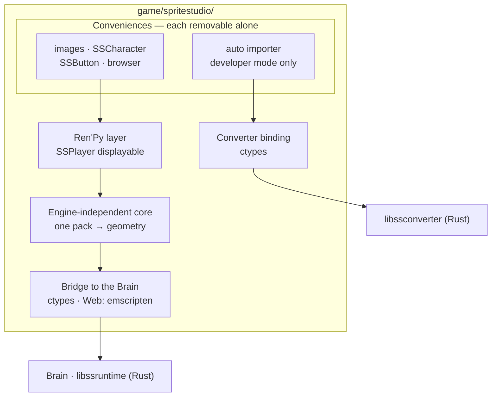

# 🧩 How the Player Is Put Together

For whoever works on SpriteStudio Player for Ren'Py, or changes it for a game of their own. It
describes the parts by what they do; the [Build Guide](build.md) builds them, uses a changed copy
in a game and checks it in Ren'Py.

What every SpriteStudio Player shares — how playback, motion blending, sound keys and part
tracking behave — is written once, in the SDK's
[Player Porting Guide](https://github.com/cri-middleware/SpriteStudio-SDK/blob/HEAD/libs/ssruntime/docs/README.md).

## Layers

Everything a game needs ships as `game/spritestudio/`: Ren'Py scripts at the top, a Python
package under `python/`, the native libraries under `libs/`.

The **Brain** is `libssruntime`, the SpriteStudio-SDK's playback runtime, written in Rust. It
advances the timeline, computes every part's pose, simulates particles and hands back each frame
as a draw plan: FlatBuffers plus flat vertex buffers. The rest of the player turns that plan into
Ren'Py renders, in four layers. An arrow is a call:

From the bottom up:

- **The bridge to the Brain** loads the native library and exposes its C API through `ctypes`; on
  the Web it talks to the Brain's WebAssembly build through `renpy.emscripten` instead. A binding
  of the same kind reaches `libssconverter`, which the importer converts with.
- **The engine-independent core** plays one pack and turns its draw plan into geometry: instance
  parts, effects, masks, events, and what the `.ssab` holds that the Brain does not hand over.
  Nothing in it imports `renpy`, so `scripts/run-tests.sh` runs all of it in plain CPython. The
  `.ssab` readers under it are generated, never edited.
- **The Ren'Py layer** loads the Brain at `init -10`, holds the `SS_*` settings, and defines
  `SSPlayer`, the Creator-Defined Displayable, whose `render()` builds a `renpy.Render` from the
  plan — GL2 meshes and shaders, with masks, attachments, audio and save support around it.
- **The conveniences** sit on top and can each be removed alone: every pack as an image,
  `SSCharacter`, the helpers, the buttons (`SSButton`), the browser (Shift+B), the diagnostics.
  The auto importer is one of them and runs only with `config.developer` on.

The Brain's work is native. What runs in Python is walking the plan and building Ren'Py's meshes,
vertex by vertex, so a frame costs more as its vertex and particle counts grow. Run the game with
`SS_PROFILE=1` to log how each frame splits between building the geometry and drawing it.

## Where the Native Library Loads From

The player finds the Brain under `game/spritestudio/libs/`, one folder per platform. Each platform
loads it differently, which is why an export needs the steps the [Export Guide](../export.md)
lists:

| Platform | File | How it loads, and why |
|---|---|---|
| macOS | `libs/macos/libssruntime.framework` | By the absolute path of `Versions/A/libssruntime`, so it resolves even when Ren'Py's `.app` packaging loses the framework's symlinks |
| Windows | `libs/windows/<arch>/ssruntime.dll` | By path |
| Linux | `libs/linux/<arch>/libssruntime.so` | By path |
| Android | `libs/android/<abi>/libssruntime.so`, ABIs named as the NDK names them | By soname. Android's linker loads native code only from the app's read-only `nativeLibraryDir`, where the installer extracts the APK's `lib/<abi>/` (W^X since API 29), so a `.so` among the game files never loads. RAPT has no hook through which a game adds native code, so the library is copied into RAPT's `jniLibs` once, by hand. |
| iOS | `libs/ios/libssruntime.xcframework`, the dynamic one | Through the process itself (`CDLL(None)`). Ren'Py has no hook that links third-party native code either, so the xcframework is added to the app target once with **Embed & Sign**, as renios does for `MetalANGLE.xcframework`; dyld then loads it at launch. A static xcframework would link and be dead-stripped, leaving `CDLL(None)` nothing to find. Its slices are `.framework` bundles, which App Store validation accepts. |
| Web | `libs/web/` | The SDK's wasm-bindgen build, read out of `game.zip` when the game starts, so an export needs no edit to its `index.html` |

The player's own `build.classify` rules keep the Android and iOS libraries out of the packaged
game files, where they would ship a second time. A desktop library that is missing does not stop
the build: the package is made, and the game stops at launch, because the Brain is loaded at
`init -10`.

## Why It Is Built the Way It Is

Each reason here spans files; the code it concerns carries the detail in its comments.

**Attachments are composited inside `SSPlayer.render()`,** in the pass that computes the frame's
pose. That is why a child attached with `ss_attach` never lags the animation: a separate drive
step could run at the wrong moment and draw the child against the previous frame's pose.

**Part overrides live in the Brain.** It applies them on the resolved pose and owns their
lifecycle — a new animation drops visibility and non-Permanent color / cell overrides, a new pack
drops everything — so the core keeps no copy. `SSPlayer` keeps a record only to put them back
after a load, when Ren'Py rebuilds the native core.

**A mirrored part reaches an attachment as a rotation.** A part's pose is described as a rotation
and two scale magnitudes — what `ss_part_transform` returns — so the sign that carries a
reflection is dropped, and a part mirrored left to right reads as a half-turn. Carrying the
reflection needs the pose as a matrix, which the player leaves to a later step; ROADMAP's
**Flip and offset** item is where the root transform would reach the part's pose.

**Masks are a coverage bitmap, not a stencil.** Ren'Py's GL2 model layer exposes no stencil
buffer, so each frame rasterizes the mask writers into an offscreen bitmap, one bit per writer,
and each masked part's shader replays the writers at its position to rebuild the stencil. The
planning is in the engine-independent core, the drawing and the GLSL in the Ren'Py layer, and the
`SS_MASK_*` settings set the bitmap's size and quality.

**A button is a `Button` of its own, not a `focus_mask` function on `button`.** The function Ren'Py
calls gets a point measured from the button's top left, and cannot see where the button put its
child: padding, alignment and the player's own origin all lie between. `SSButton` subclasses
`Button`, so it reads where `Window.render` placed the player, its state from its own style prefix,
and the held-down state Ren'Py's buttons lack from the mouse button. Nor is it a screen-language
statement: one has to be registered by a file loaded before every file that uses it, and
`game/spritestudio/` sorts after `screens.rpy`. A player Ren'Py shows afresh starts its
constructor's animation over inside its own `render()`, so the button checks after rendering whether
the player still plays its state's section, and renders once more when it does not.

**The importer rides Ren'Py's autoreload.** The auto importer runs at `init -10`, so it runs at
every launch and every reload. It claims the source folder in `config.autoreload_functions`
ahead of Ren'Py's own image and audio rules, which would otherwise flush a cache and not reload
for a saved `.png`. Freshness is a marker written only after a successful conversion, because a
failed one leaves fresh-looking files behind; `tools/ss_stamp_import.py` writes the same marker
over a pack converted elsewhere.
