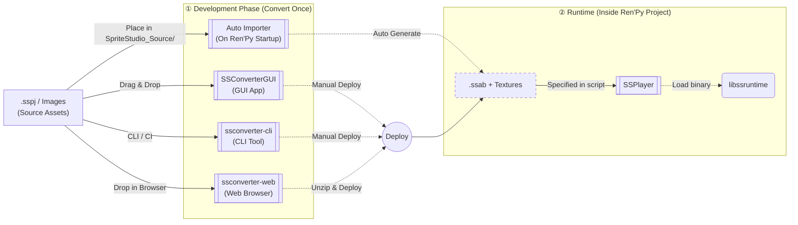
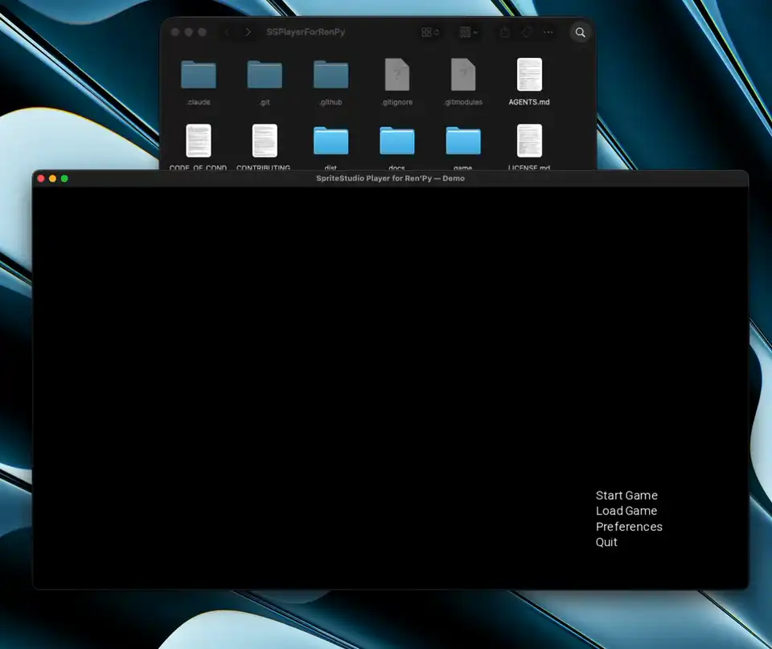

# 🗂️ Asset Import

The `.sspj` file is converted to `.ssab` **only once during development**. At **runtime (during gameplay)**, the game simply loads the converted `.ssab` and textures to render the animation. You do not need to include the original `.sspj` workspace files in your final distributed game.

We provide multiple conversion methods to suit your project's scale and workflow.



> [!TIP]
> If you do not have a `.sspj` yet and just want to try this out, the [official SpriteStudio sample data](https://www.webtech.co.jp/help/ja/spritestudio7/download/sample/) works as-is (that page is only available in Japanese; the downloads themselves are language-neutral). [Ringo](https://www.webtech.co.jp/help/ja/spritestudio7/download/sample/#ringo) is a good character sample, and [Particle](https://www.webtech.co.jp/help/ja/spritestudio7/download/sample/#Perticle_sample) is a good one if you want effects. The downloaded project feeds any of the conversion methods below as-is.

> [!NOTE]
> **Which SpriteStudio file becomes which converted file** (the roles of `.sspj` / `.ssae` / `.ssce` /
> `.ssqe` and how they map) is the same for every Player, so it is documented in the portal —
> [Asset Conversion — How a project's files map to the output](https://cri-middleware.github.io/SpriteStudio-Docs/overview/conversion/#how-a-projects-files-map-to-the-output).
>
> Two points matter. **One `.ssae` becomes one `.ssab`**, and **cell positions are baked from the
> `.ssce` into the `.ssab`**. Because of the latter, whenever you add, move or resize cells, or change
> the image size, **rebuild the `.ssab` and ship it alongside the image** — replacing the image alone
> leaves the old source rectangles in place and the artwork shifts.

---

## Method 1: Auto Importer

This feature automatically detects updates to `.sspj` files when Ren'Py starts, runs the conversion behind the scenes, and imports them into your game. It is recommended for quick iterations (adjustments and verification) as it eliminates the hassle of manual conversion.

> [!WARNING]
> This feature only works **when Ren'Py is launched in developer mode (`config.developer = True`)**. The conversion process will not run in release builds meant for players.

### Basic Usage

1. Create a folder named **`SpriteStudio_Source`** in the root directory of your game project (at the same level as the `game/` folder).
2. Inside the created `SpriteStudio_Source` folder, place the entire project dataset (`.sspj`, `.ssae`, images, etc.) created in SpriteStudio.
3. Launch your Ren'Py project, or press `Shift + R` in one that is already running.

**Result:**
If a file update is detected during the startup initialization phase, the conversion will run automatically, and a folder with the same name as the project will be generated under **`game/ss_assets/`**.
(Example: If you placed `SpriteStudio_Source/Ringo/Ringo.sspj`, the converted data will be output to `game/ss_assets/Ringo/`.)

> [!NOTE]
> **One output folder per project name.** The folder is named after the `.sspj`, so two projects with the same file name — `Enemies/Boss/Enemy.sspj` and `Enemies/Minion/Enemy.sspj`, say — would both write into `game/ss_assets/Enemy/`. Only the first in path order is converted; the others are skipped, and the in-game notice and the console say which. Rename one of the `.sspj` files to import both. Names that differ only in case count as the same name, because they are one folder on Windows and macOS.
>
> **Updating SpriteStudio Player for Ren'Py converts every project once more.** A project is converted again whenever the converter in `game/spritestudio/` differs from the one that last converted it, so after you replace that folder with a newer release, the next launch brings every project up to date. That launch takes longer than usual.
>
> **The importer deletes nothing.** Remove or rename an `.ssae`, an image or a sound, and the file converted from it stays in `game/ss_assets/<project>/`, where it still loads, lists in the Asset Browser, is registered as an image and ships with the game. After each conversion the importer names such files on the console and counts them in the in-game notice; delete the ones nothing uses.

### Hot reload

Press **`Shift + R`** once in the running game and you are done pressing it: the Auto Importer hands your `SpriteStudio_Source/` files to Ren'Py's autoreload, so from then on **saving in SpriteStudio re-imports and reloads the game on its own**. The change is picked up by modification time, only the updated project is re-converted, and the asset index is refreshed. Dropping a whole new project into the folder works the same way. Each import reports itself in the running game — `SpriteStudio: imported Ringo`, or the same line naming what failed and pointing at the console — so a save that did not land is never silent.

> [!WARNING]
> **`Shift + R` is Ren'Py's autoreload toggle, not a refresh button.** The first press turns autoreload **on** and reloads; press it again and it turns **off** without reloading — which is why the second press looks like it did nothing. Press it once per launch and leave it alone. The Auto Importer prints which side you are on at startup (`Hot reload ON` / `Hot reload OFF`). `Alt` (`Option`) `+ R` is the same command; `Ctrl + R` is not bound to it — `Ctrl` is Ren'Py's skip key.

> [!TIP]
> **See it in action — live iteration with an external tool.** Edit the animation in SpriteStudio and save it: with hot reload on, the running Ren'Py re-converts only the updated project and shows the result on the spot (developer mode only).
>
> <video autoplay loop muted playsinline width="100%">
>   <source src="assets/1-auto_import_live.webm" type="video/webm">
> </video>
> 

> [!TIP]
> **Customizing Output Paths**
> If you want to change the source location or output destination path, you can override them by defining variables on the Ren'Py script side.
> ```renpy
> # Example: Define this in options.rpy or similar, before the auto-importer (init -10)
> define -15 ss_source_dir = "my_custom_source_folder"
> define -15 ss_output_dir = "game/my_converted_assets"
> ```

---

## Method 2: Manual Conversion via Standalone GUI Tool (`SSConverterGUI`)

If you are not familiar with command-line operations or prefer to convert files easily using drag-and-drop, we recommend using the dedicated desktop application **`SSConverterGUI`**.

### Download and Usage

1. Download and launch the latest version suitable for your OS from the [SSConverterGUI Releases page](https://github.com/cri-middleware/SSConverterGUI/releases).
2. Directly **drag and drop** the `.sspj` file or a folder containing `.sspj` files into the designated area of the application window.
3. (Optional) Specify the output directory and press the "Convert" button to generate the `.ssab` files all at once.
4. After conversion, manually move the output folder into your Ren'Py project's `game/` directory (e.g., `game/ss_assets/Ringo/`).

> [!NOTE]
> It is extremely easy to use, as dropping a folder automatically finds and batch-converts all `.sspj` files inside it.

---

## Method 3: CLI / CI using CLI Converter (`ssconverter-cli`)

For automated builds in CI/CD (Continuous Integration) or batch processing across large-scale projects, we recommend using the independent execution tool **`ssconverter-cli`**. This tool, which is also commonly used for Godot and Unity, allows you to perform conversions directly from the command line without needing Python or Ren'Py execution environments.

### How to Download

From the [SpriteStudio-SDK Releases page](https://github.com/cri-middleware/SpriteStudio-SDK/releases), download the `ssconverter-cli` executable suitable for your OS (e.g., a ZIP containing `ssconverter-cli.exe` for Windows) and extract it to a folder of your choice.

> [!NOTE]
> The `ssconverter-cli` binary is not bundled with SpriteStudio Player for Ren'Py. If you wish to use the CLI, please obtain it separately from the SDK repository.

### Basic Usage

Open your terminal (Command Prompt or bash script) and execute the following command. The simplest way is to specify just the input file without the `-o` option.

```bash
# Basic Syntax
ssconverter-cli <path_to_input.sspj>

# Execution Example
ssconverter-cli SpriteStudio_Source/Ringo/Ringo.sspj
```

- Executing the above generates a folder with the same name as the project (e.g., `Ringo/`) in the same directory as the `.sspj` file, and outputs the `.ssab` and image files inside it.
- After conversion, manually move and place the generated folder into your Ren'Py project's `game/` directory (e.g., `game/ss_assets/Ringo/`).
- *If you want to output directly to an arbitrary location, you can use the `-o <output_directory_path>` option.*

### Batch Processing via Directory Specification

By specifying a directory path instead of a file, it will automatically find all `.sspj` projects within that directory and convert them all at once.

```bash
# Batch convert all projects under the specified folder
ssconverter-cli SpriteStudio_Source/
```
This is very convenient when you want to convert and update animation data for multiple characters or scenes in one go.

---

## Method 4: Web-based Converter (`ssconverter-web`)

If you want to try conversion quickly in your browser without installing any tools, you can use **`ssconverter-web`**, which is included in the sister project SpriteStudio Player for Web.

- It uses WebAssembly to process files locally within the browser, meaning your files are never uploaded to an external server.
- Simply drag and drop the `.sspj` and related files (like images) into the browser window. The converted result will be **downloaded as a `.zip` file**.
- Unzip the downloaded `.zip` file, and place the generated `.ssab` and images together in your `game/` folder.

It is hosted on the SpriteStudio Player for Web site at
`https://cri-middleware.github.io/SSPlayerForWeb/ssconverter/` (_coming soon_ — the address is
final, but it 404s until SpriteStudio Player for Web publishes its site). Folder selection uses
the **File System Access API**, so a **Chromium-based browser (Chrome / Edge)** is required.

For details, please refer to the documentation in the [SSPlayerForWeb repository](https://github.com/cri-middleware/SSPlayerForWeb).

---

## Release Builds and Archives (`.rpa`)

Because `.ssab` files and textures (PNG / WebP) are loaded via Ren'Py's loader, **they can be successfully loaded even if included in an `.rpa` archive**. Textures go through Ren'Py's standard image pipeline (`Image`), so any format Ren'Py supports — PNG or WebP — works just like every other image in your project.
When archiving `game/` for distribution builds (e.g., via `build.classify`), you may simply leave them to be archived. They will also work properly if left as loose files.
