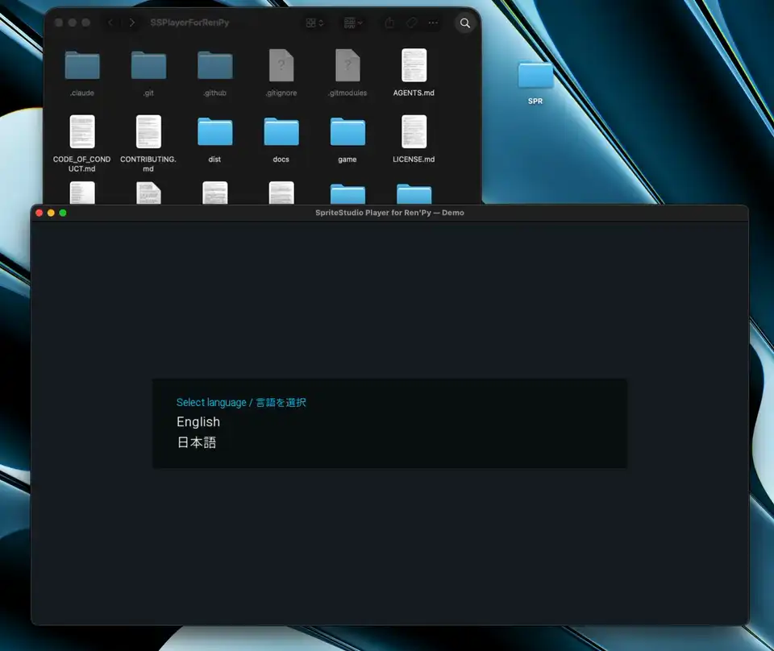

# Usage Guide

In SpriteStudio Player for Ren'Py, you have very flexible control over SpriteStudio animations within Ren'Py. This guide explains how to use the player depending on your goals, ranging from simple rendering to integrating character standing images, and handling event callbacks.

> [!IMPORTANT]
> **Placement of `.ssab` files**
> The converted `.ssab` file, its textures (`.png`), and any referenced external instance packs must **reside in the same folder** (the auto importer outputs them to `game/ss_assets/<ProjectName>/`). Because the player resolves related resources from the same directory as the `.ssab`, you do not need to specify a separate folder for textures.

---

## 1. The Simplest Playback (Calling from a Screen)
Because the `SSPlayer` class acts as a Ren'Py Displayable (drawing object), the simplest way to show an animation is by `add`ing it directly into a screen.

```renpy
screen demo():
    # The first argument is the path to the .ssab (relative to game/)
    add SSPlayer("ss_assets/Ringo/Ringo.ssab") xalign 0.5 yalign 0.5
```

### Basic Parameters
- **1st Argument**: The path to the `.ssab` to play (relative to `game/`, e.g. `"ss_assets/Ringo/Ringo.ssab"`). Because the `.ssab` and its textures and external instance packs live together, this is enough to resolve the related resources. **You can also load an `.ssab` from an `.rpa` archive** (via the Ren'Py loader).
- **`animation` (Optional)**: The name of the animation to play initially. If omitted, the first animation in the data is played. **If you pass a non-existent name, it will result in an error** (with a list of valid animation names) on the first display.
- **`loop` (Optional)**: Playback count. `-1` (default) for infinite loop, `1` for a single play, `N` for N plays. `0` is a synonym for `-1` (infinite), not "do not play".
- **`speed` (Optional)**: Playback speed multiplier (default `1.0`).
- **`size` (Optional)**: If you pass `(w, h)` (or a single number for a square), it acts as a **normal image of that bounding box size**, allowing `xalign`/`xpos`/`pos` and container layouts to work directly (the animation is drawn at the center of the box). If omitted, it occupies the entire screen, and you must use `xoffset`/`yoffset` for positioning. In both cases, scaling via `zoom`/`Transform` applies.

```renpy
# You can place it with align if you specify size
add SSPlayer("ss_assets/Ringo/Ringo.ssab", size=(400, 600)) xalign 0.5 yalign 1.0
```

> [!TIP]
> Not sure which pack or animation to use? Open the **Asset Browser** with **Shift+B** in developer mode to browse every `.ssab`, preview animations live, and copy a ready-to-paste snippet. See the **Asset Browser** section (§9) below.

> [!NOTE]
> The old `sprites_subdir` argument remains for backward compatibility, but it is unnecessary when specifying the path (deprecated).

---

## 2. Using as Standing Images (`image` statement and Character integration)
By combining it with Ren'Py's `image` statement, it functions powerfully as a **character standing image** (tachie) in visual novels. Using the `aliases` argument, you can link Ren'Py attribute names to SpriteStudio motion names.

```renpy
# Character definition (specify the .ssab path)
image ringo = SSPlayer(
    "ss_assets/Ringo/Ringo.ssab",
    aliases={
        "idle": "wait1",    # When 'idle' is called, play the 'wait1' motion
        "happy": "joy",
        "walk": "walk",
        "attack": ["attack1", "wait1"] # Pass a list to play them sequentially!
    }
)

define r = Character("Ringo", image="ringo")

label start:
    # Show default standing image (idle motion)
    show ringo idle:
        yoffset 200

    r happy "The motion switches just by changing the attribute!"

    # Make them walk by combining with Transform
    show ringo walk:
        xoffset -400 yoffset 200
    with move

    r attack "Attack! (It automatically returns to wait1 when attack1 ends)"
```

### Even Easier: Talking Character (`SSCharacter`)
Using `SSCharacter`, you can define a "living character" in one line that **automatically switches to 'talk' while speaking, and 'idle' when stopped**. This prepares the `image` declaration, `Character` definition, and lip-sync synchronization all at once, removing the need for line-by-line Python.

```renpy
# Register image + Character + lip-sync linked definition (tag is .ssab stem = "ringo")
define ringo = SSCharacter(
    "ss_assets/Ringo/Ringo.ssab",
    talk="talk",     # Animation name to play while speaking
    idle="wait1",    # Animation name when silent
)

label start:
    show ringo            # Show with tag "ringo"
    ringo "Hi. It stays on 'talk' while speaking, and returns to 'idle' when finished."
```

- The image tag is the lowercased file stem of the `.ssab` (e.g., `"ringo"`). You can override it with `tag=`.
- You can also pass `aliases=` (for emotions, etc.) and `size=` (box size for `xalign`).
- The lip-sync start/stop timing can be adjusted using `start` / `stop` (Character callback event names).

> [!WARNING]
> **v1 Limitation**: Because talk/idle replace attributes while speaking, emotion attributes like `show ringo happy` won't reflect during `talk`, and it will return to `idle` afterwards (emotion-specific talks will be supported in the future).

---

## 3. Using as Effects (Loop Count Control)
For animations like magic explosions or hit effects that play once and end, you can restrict the playback count with the `loop` argument.

```renpy
image hit_effect = SSPlayer(
    "ss_assets/ParticleEffect/e038.ssab",
    animation="hit",
    loop=1 # End and disappear from the screen after 1 playback (or stop on the last frame)
)

label battle:
    # Show the effect at a specific position matching the attack
    show hit_effect:
        xoffset -150 yoffset 50
    "KABOOM!"
```

---

## 4. Dynamic Control from Python
You can switch animations directly from Python (scripts) or retrieve information depending on the game logic.

```renpy
$ player = SSPlayer("ss_assets/Ringo/Ringo.ssab")

# Get a list of all included animation names
$ anim_names = player.ss_animation_names()

# Get the currently playing animation name
$ current_anim = player.ss_get_animation()

# Switch to an arbitrary animation (switch + cue -> play)
$ player.ss_play("run")
```

- **Separation of Switching and Playback**: `ss_set_animation("run")` only switches to the animation and cues it; it does not start playing. `ss_play()` starts the playback.
- **Switching is cheap**: everything the `.ssab` needs — textures included — is loaded in one go when the sprite is first shown, so `ss_set_animation()` is light enough to call every frame (there is no per-animation loading).
- **Playback Control**: `ss_pause()` / `ss_resume()` / `ss_stop()`, frame control `ss_set_frame()` / `ss_get_frame()`, speed `ss_set_speed()`, and looping `ss_set_loop()` are available.
- **Part Query**: `ss_part_transform("part_name")` retrieves the local transform (x/y/rotation/scale) of the part for the most recent frame. For the whole part-query set, and for making a displayable follow a part, see the **Part Tracking** section (§5) below.

---

## 5. Part Tracking (Following a Specified Part)

A feature that makes a displayable you provide (a weapon, an effect, a hit marker) follow a specified part every frame. This player has no scene tree to place the follower into, so the child is **composited into the player's own render** at the part's position. You own the child and its contents; the player only draws it — and because it rides inside the player's render, any `at` clause, `Transform`, or `zoom` applied to the player carries the child along with it.

> The child can be any Ren'Py displayable: an image name, a `"file.png"`, a `Text(...)`, a `Solid(...)`, a `Transform(...)` — even another `SSPlayer`.

Configure it by passing `attachments=` to the constructor, as a `{part_name: child}` dict.

```renpy
image ringo = SSPlayer(
    "ss_assets/Ringo/Ringo.ssab",
    attachments={"head": Text("!", size=40), "hand_r": "sword.png"},
)
```

| Setting | Description |
|---|---|
| **part** | The name of the part to follow (the PartData name in the `.ssab`). `ss_part_names()` lists them, and the Asset Browser (Shift+B) shows them per pack |
| **child** | The displayable to make follow |
| **anchor** | Which point of the child is pinned to the part, as a 0–1 fraction of its size. `(0.5, 0.5)` centers it (default); `(0.5, 1.0)` puts its bottom edge on the part — the grip of a held item. This is also the rotation / scale pivot |
| **angle** | A fixed rotation offset in degrees (clockwise-positive) added on top of the part's own rotation, so the child's rest orientation lines up with the part's local axis |
| **drive_scale** | When ON, the part's scale is also reflected. OFF (default) is position and rotation only |
| **on_hide** | Behavior on frames where the part is hidden. `"follow"` (keep drawing; default) / `"hide"` (drop the child for those frames) |

### Registering from a Script

Attachments can also be added and removed at runtime instead of through the constructor.

```renpy
# Grip the sword by its bottom edge and lay it along the fingers
$ sword = ringo.ss_attach("hand_r", "sword.png", anchor=(0.5, 1.0), angle=-90)

# Also reflect the part's scale, and stop drawing on hidden frames
$ ringo.ss_attach("head", "aura.png", drive_scale=True, on_hide="hide")

# Remove (by child, by part, or all of them)
$ ringo.ss_detach(child=sword)
$ ringo.ss_detach(part="hand_r")
$ ringo.ss_clear_attachments()
```

| Method | Description |
|---|---|
| `ss_attach(part, child, drive_scale, on_hide, anchor, angle)` | Adds an attachment and returns the normalized child (pass it back to `ss_detach`) |
| `ss_detach(child=None, part=None)` | Removes every attachment matching that child and / or part, and returns the number removed. With neither given it removes nothing |
| `ss_clear_attachments()` | Removes every attachment and returns the number removed |
| `ss_attachments()` | The current attachments as `(part_name, child)` pairs |
| `ss_part_names()` / `ss_part_index(part_name)` | The pack's part names / one part's index (`-1` if the part is not in the asset) |
| `ss_is_part_hidden(part_name)` | Whether the part is hidden on the last rendered frame |
| `ss_part_transform(part_name)` | The part's transform for the last rendered frame, or `None` |

> When you only need the part's position at a single moment (a projectile spawn point, for example) rather than continuous following, calling `ss_part_transform()` directly is simpler.

> **`show <tag>` draws a copy.** An `SSPlayer` registered with `image` is duplicated every time it is shown, so `attachments=` given to the constructor does carry into the copy — but a later `ss_attach()` on the variable you kept edits the template, not what is on screen. To attach while the game runs, keep one instance and show that object with `show expression player as tag`.

### Timing and Accuracy

Attachments are composited inside the player's own `render()`, in the same pass that computes the frame's pose, so **a child never lags the animation** — there is no separate drive step that could run at the wrong moment.

`ss_part_transform()` returns the pose the compositing itself uses, in player-local pixels with the animation's origin at the center of the player's box.

| Key | Meaning |
|---|---|
| `x` / `y` | Position in px, relative to the animation origin. Y is **down-positive** |
| `rotation` | Degrees, **clockwise-positive** |
| `xscale` / `yscale` | Scale as a **magnitude** (always positive) |

It returns `None` until the first frame has been rendered, and for a part that is not in the frame being drawn. A child whose part reads `None` is simply skipped for that frame.

`anchor` doubles as the rotation / scale pivot, and the child's unrotated size is measured every frame, so a child that changes size keeps its anchor. A hand part carries the wrist angle, so a held item usually needs an `angle` offset to lie along the fingers rather than standing straight up.

Because `xscale` / `yscale` are magnitudes, a **mirrored (negative-scale) part is not mirrored on the child** — under `drive_scale` a flipped part scales the child by the absolute amount instead of flipping it.

### Notes

- **Children draw in front of the whole sprite.** They cannot be inserted between parts, so a child cannot be made to pass behind the character's body.
- The part name does not have to exist yet. A child registered for a part that is not in the current animation is simply not drawn, and starts riding on its own once the part appears.
- Part names resolve against the parts of the pack the player itself is playing. **Parts inside an Instance part (the child animation) cannot be specified** (the Instance part itself can).
- If several parts share a name, the **last** one in the pack is used. Rename duplicates in SpriteStudio when you need a specific one.
- Prefer a **Normal (image) part** as the target. A Mesh part's pivot stays where the undeformed part was, so a child pinned to it drifts away from the deformed shape you see on screen.
- Several children can ride the same part, and one player can carry as many attachments as you like.
- Attachments are plain data, so they are **saved with the game and survive rollback** — there is no re-registration step after a load.
- A child that fails to render is skipped for that frame and can never break the sprite.

---

## 6. Part Overrides (Part Color / Cell / Visibility)

Per-part runtime overrides let a script say "make this part this color / this cell / hidden **now**". An override wins over both the keyframe and any animation blending, so it does not have to fight the animation.

```renpy
$ ringo = SSPlayer("ss_assets/Ringo/Ringo.ssab", animation="wait1")

# Tint a part red (1 = Mul). Applies to normal (image) parts.
$ ringo.ss_set_part_color_override("apple", "#f00", blend_op=1)

# Make a part draw a different cell (cellmap name is written without ".ssce").
$ ringo.ss_set_part_cell_override("apple", "Ringo", "effect3")

# Force-hide a part, cascading to its descendants.
$ ringo.ss_set_part_visibility_override("apple_base", True, cascade=True)

# Revert
$ ringo.ss_clear_part_color_override("apple")
$ ringo.ss_clear_all_part_overrides()
```

| Method | Description |
|---|---|
| `ss_part_index(part_name)` | Part index, or `-1` if the part is not in the asset |
| `ss_set_part_color_override(part, color, blend_op=0, priority=1)` | Part Color override (single color) |
| `ss_set_part_color_override_corners(part, corners, blend_op=0, priority=1)` | Four-corner form: left-top, right-top, left-bottom, right-bottom |
| `ss_set_part_cell_override(part, cellmap_name, cell_name, priority=1)` | Draw a different cell |
| `ss_set_part_visibility_override(part, hide=True, cascade=False)` | Force-hide (`hide=False` reverts to the animation) |
| `ss_clear_part_color_override` / `ss_clear_part_cell_override` / `ss_clear_part_visibility_override` | Clear one override on one part |
| `ss_clear_all_part_overrides()` | Clear every override on the player |
| `ss_cellmap_names()` / `ss_cell_names(cellmap_name)` | Discover the cellmap / cell names you can pass to a cell override |

The `part` argument of every method takes either a **part name** or a **part index**, and the call returns `False` when the part is unknown or the runtime rejects it.

**Colors** take any Ren'Py color form — `"#f00"`, `(255, 0, 0)`, `Color(...)`, or a packed `0xRRGGBBAA` int.

The cellmap / cell names you can pass to a cell override are enumerated from the pack:

```renpy
$ print(ringo.ss_cellmap_names())       # -> ["Ringo", ...]
$ print(ringo.ss_cell_names("Ringo"))   # -> ["effect3", ...]
```

> **On using part indices**: Part indices are stable within one asset (the same `.ssab`), so if you set overrides frequently, resolve the name once with `ss_part_index()` and reuse that index.

### Blend operation (`blend_op`)

The `blend_op` of `ss_set_part_color_override()` offers the same four operations as the keyframed Part Color.

| Value | Blend operation |
|---|---|
| `0` | Mix (default) |
| `1` | Mul (multiply) |
| `2` | Add |
| `3` | Sub (subtract) |

An out-of-range value fails the call and returns `False`.

### Priority mode (`priority`)

Part Color and cell overrides conflict with the animation, so they take a `priority` (visibility does not — it is a plain force-hide flag, and any new animation clears it):

| Value | Priority mode | Behavior |
|---|---|---|
| `0` | OverwriteOnNextKeyframe | The override applies until the animation data updates that attribute |
| `1` | HoldUntilNextAnimation (default) | The override wins for the current animation and is cleared when a new animation is set up |
| `2` | Permanent | The override applies for as long as the same animation data (`.ssab`) is playing, surviving animation changes |

### Notes

- **Color** applies to normal parts, **cell** to normal and mask parts; other part types silently ignore the override (the call still returns `True`).
- Colors are interpreted in the same 8-bit sRGB space as the authored Part Color, and alpha is pre-multiplied by the runtime — pass the color as authored, without converting it yourself.
- A cell override is resolved when you set it, so an unknown cellmap / cell name fails immediately (returns `False`).
- Overrides live on the runtime, which owns their lifecycle. Do not re-apply them after an animation change; choose the priority mode that expresses what you want instead.
- Overrides are restored when a saved game is loaded, so a costume change survives save / load. One-shot (`priority=0`) overrides are the exception — they are momentary by design and are not carried across a save.
- Overrides do not reach parts **inside** an instance part (the child animation runs as a separate player). Force-hiding the instance part itself does stop its contents from being drawn.

> **On when an override is reflected in the drawing**: setting or clearing an override redraws the sprite immediately, even while playback is stopped or paused — you do not have to nudge the frame to make it appear.

---

## 7. Handling Animation Events (User Data / Signals)
You can receive information on "User Data" and "Signals" configured on the SpriteStudio side within Ren'Py. This makes it possible to play sound effects on specific frames or synchronize script progression.

### Receiving via Callbacks (Event-Driven)
By passing corresponding functions during the `SSPlayer` instance creation, you can trigger logic at specific timings.

```python
init python:
    def my_signal_handler(player, frame, signal):
        print(f"Signal Received: Command={signal.command_id}, Params={signal.params}")

    def my_finish_handler(player):
        print("Animation reached the end")
```
```renpy
# Register callbacks and play
image boss = SSPlayer(
    "ss_assets/Boss/Boss.ssab",
    on_signal=my_signal_handler,
    on_finished=my_finish_handler
)
```

**Available Callback Arguments:**
- `on_user_data`: Called when User Data is reached
- `on_signal`: Called when a Signal is reached
- `on_audio`: Called when an audio playback specified frame is reached
- `on_finished`: Called once every configured `loop` has played. Never fires under an infinite loop, nor on a commanded stop
- `on_looped`: Called each time a loop iteration completes; the final iteration fires `on_finished` instead
- `on_started`: Called when animation playback starts

> [!NOTE]
> Callbacks are invoked from the drawing thread in the form `cb(player, ...)` (start/finish/loop forms are `cb(player)`). To support pickling during rollback, please pass module-level functions rather than lambdas or local functions.

*Note: For polling-based retrieval (`ss_poll_events()`), refer to implementations like `ss_drain_events()` inside `script.rpy` of the demo project.*

---

## 8. Utilities

### One-Shot Playback Made Easy (`ss_play_once`)
Plays any `.ssab` once (effect or full-screen cutscene). With `wait=True`, it waits until playback finishes and automatically disappears; hide a non-waiting one with `ss_hide_once(tag)`.
```renpy
$ ss_play_once("ss_assets/ParticleEffect/e038.ssab", "hit",
               at=Transform(xpos=640, ypos=360), wait=True)
```
`ss_duration("…/Ringo.ssab", "attack1")` returns the duration in seconds for one cycle of that animation, so a character's "play and wait" can be written as `show ringo attack` + `$ renpy.pause(ss_duration(...))`.

### Checking Behavior (Diagnostics)
In developer mode, "runtime loaded / N pack(s)" is output to the log on startup. By calling `ss_diagnostics()` in the console (Shift+O), you can check the runtime status and a list of detected packs. If an `.ssab` cannot be read, you will get a clear error containing its path (relative to `game/`).

---

## 9. Asset Browser (Shift+B): Discover, Preview, and Copy Snippets

Press **Shift+B** in developer mode to open the **Asset Browser** — a built-in inspector that turns "which pack do I play, and how?" into a two-click answer. It is developer-mode only (the hotkey is disabled in release builds) and overlays the running game, so you can call it up at any time.

> [!TIP]
>
> <video autoplay loop muted playsinline width="100%">
>   <source src="../assets/2-asset_browser.webm" type="video/webm">
> </video>
> 

The window has three panes:

1. **Pack list (left).** Every `.ssab` the resolver can find under `ss_assets/` — including packs bundled inside an `.rpa` archive. Click one to select it.
2. **Live preview (center).** The selected animation plays for real (not a static thumbnail), alongside a metadata line — number of `animations`, `fps`, whether it has `effects`, and any external instance packs. Click any animation in the list to preview it instantly.
3. **Snippet (right).** Pick a **role** — Character / One-shot / UI — and a ready-to-paste `.rpy` snippet is generated for that pack. The default role is inferred from the pack's contents (an effect-only pack defaults to One-shot, for example), so you choose the role while watching the animation instead of guessing.

Exporting the snippet appends it to **`ss_snippets.txt`** in your project root and copies it to the clipboard, ready to paste straight into your script. Press **Esc** to close.

Because the browser reads through the same zero-config resolver as `SSPlayer`, anything it lists is guaranteed to load by the exact path shown — including packs the [Auto Importer](import.md) just generated, since the asset index is refreshed on import.

### Stays in sync with the Auto Importer

You do not have to relaunch to pick up a brand-new pack. Drop a new project into `SpriteStudio_Source/`, press **Shift+R** to reload, and the [Auto Importer](import.md) converts it and refreshes the index — reopen the browser (**Shift+B**) and the new pack is in the list, ready to preview on the spot.

> [!TIP]
>
> <video autoplay loop muted playsinline width="100%">
>   <source src="../assets/3-asset_browser_autoimport.webm" type="video/webm">
> </video>
> 
