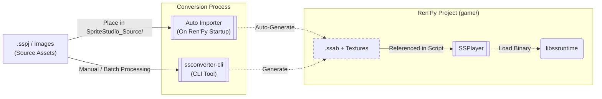

# Asset Import

SpriteStudio Player for Ren'Py does not read SpriteStudio project files (`.sspj`) directly; instead, they are converted into a binary format for Ren'Py (`.ssab`) before use. We provide two conversion methods to suit your project's scale and workflow.



---

## Method 1: Auto Importer

This feature automatically detects updates to `.sspj` files when Ren'Py starts, runs the conversion behind the scenes, and imports them into your game. It is recommended for quick iterations (adjustments and verification) as it eliminates the hassle of manual conversion.

> [!WARNING]
> This feature only works **when Ren'Py is launched in developer mode (`config.developer = True`)**. The conversion process will not run in release builds meant for players.

### Basic Usage

1. Create a folder named **`SpriteStudio_Source`** in the root directory of your game project (at the same level as the `game/` folder).
2. Inside the created `SpriteStudio_Source` folder, place the entire project dataset (`.sspj`, `.ssae`, images, etc.) created in SpriteStudio.
3. Launch or reload (`Shift + R`) your Ren'Py project.

**Result:**
If a file update is detected during the startup initialization phase, the conversion will run automatically, and a folder with the same name as the project will be generated under **`game/ss_assets/`**.
(Example: If you placed `SpriteStudio_Source/Hero/Hero.sspj`, the converted data will be output to `game/ss_assets/Hero/`.)

> [!TIP]
> **Customizing Output Paths**
> If you want to change the source location or output destination path, you can override them by defining variables on the Ren'Py script side.
> ```renpy
> # Example: Define this in options.rpy or similar, before the auto-importer (init -10)
> define -15 ss_source_dir = "my_custom_source_folder"
> define -15 ss_output_dir = "game/my_converted_assets"
> ```

---

## Method 2: Manual / Batch Processing using CLI Converter (`ssconverter-cli`)

For automated builds in CI/CD (Continuous Integration) or batch processing across large-scale projects, we recommend using the independent execution tool **`ssconverter-cli`**. This tool, which is also commonly used for Godot and Unity, allows you to perform conversions directly from the command line without needing Python or Ren'Py execution environments.

### How to Download

From the [SpriteStudio-SDK Releases page](https://github.com/cri-middleware/SpriteStudio-SDK/releases), download the `ssconverter-cli` executable suitable for your OS (e.g., a ZIP containing `ssconverter-cli.exe` for Windows) and extract it to a folder of your choice.

> [!NOTE]
> The `ssconverter-cli` binary is not bundled with SpriteStudio Player for Ren'Py. If you wish to use the CLI, please obtain it separately from the SDK repository.

### Basic Usage

Open your terminal (Command Prompt or bash script) and execute the following command. The simplest way is to specify just the input file without the `-o` option.

```bash
# Basic Syntax
ssconverter-cli <path_to_input.sspj>

# Execution Example
ssconverter-cli SpriteStudio_Source/Hero/Hero.sspj
```

- Executing the above generates a folder with the same name as the project (e.g., `Hero/`) in the same directory as the `.sspj` file, and outputs the `.ssab` and image files inside it.
- After conversion, manually move and place the generated folder into your Ren'Py project's `game/` directory (e.g., `game/ss_assets/Hero/`).
- *If you want to output directly to an arbitrary location, you can use the `-o <output_directory_path>` option.*

### Batch Processing via Directory Specification

By specifying a directory path instead of a file, it will automatically find all `.sspj` projects within that directory and convert them all at once.

```bash
# Batch convert all projects under the specified folder
ssconverter-cli SpriteStudio_Source/
```
This is very convenient when you want to convert and update animation data for multiple characters or scenes in one go.

---

## Release Builds and Archives (`.rpa`)

Because `.ssab` files and textures (`.png`) are loaded via Ren'Py's loader, **they can be successfully loaded even if included in an `.rpa` archive**.
When archiving `game/` for distribution builds (e.g., via `build.classify`), you may simply leave them to be archived. They will also work properly if left as loose files.
