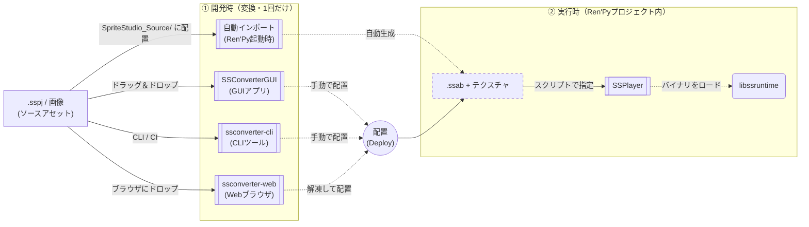
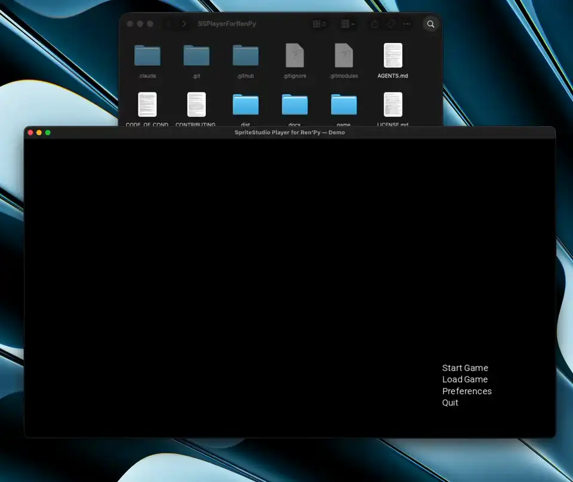

# 🗂️ アニメーションデータのコンバート (Import)

`.sspj` は **開発時に一度だけ** `.ssab` へ変換し、**実行時（ゲームプレイ中）** はその `.ssab` とテクスチャを読み込んで描画するだけです。プレイヤーに配布するゲーム本体に元の `.sspj` 等を含める必要はありません。

プロジェクトの規模やワークフローに合わせて、以下のコンバート方法を提供しています。



> [!TIP]
> 手元に `.sspj` がまだ無い状態で試したい場合は、[SpriteStudio 公式のサンプルデータ](https://www.webtech.co.jp/help/ja/spritestudio7/download/sample/)がそのまま使えます。キャラクターなら [Ringo](https://www.webtech.co.jp/help/ja/spritestudio7/download/sample/#ringo)、エフェクトを含むものなら [パーティクル](https://www.webtech.co.jp/help/ja/spritestudio7/download/sample/#Perticle_sample) が手頃です。ダウンロードしたプロジェクト一式は、以下のどのコンバート方法にもそのまま渡せます。

---

## 方法1: 自動インポート機能 (Auto Importer)

Ren'Pyの起動時に `.sspj` ファイルの更新を自動で検知し、裏側でコンバートを実行してゲーム内に取り込む機能です。手動コンバートの手間を省き、素早くイテレーション（調整・確認）を回したい場合におすすめです。

> [!WARNING]
> この機能は **Ren'Pyが開発者モード (`config.developer = True`) で起動した場合のみ** 動作します。プレイヤー向けのリリースビルドではコンバート処理は走りません。

### 基本的な使い方

1. ゲームプロジェクトのルートディレクトリ（`game/` フォルダと同じ階層）に **`SpriteStudio_Source`** という名前のフォルダを作成します。
2. 作成した `SpriteStudio_Source` フォルダの中に、SpriteStudioで作成したプロジェクト一式（`.sspj`, `.ssae`, 画像など）を配置します。
3. Ren'Pyのプロジェクトを起動、またはリロード（`Shift + R`）します。

**実行結果:**
起動時の初期化フェーズでファイルの更新が検知されると自動的にコンバートが走り、プロジェクト名と同名のフォルダが **`game/ss_assets/`** 以下に生成されます。
（例: `SpriteStudio_Source/Ringo/Ringo.sspj` を配置した場合、`game/ss_assets/Ringo/` に変換データが出力されます）

> [!TIP]
> **動作イメージ — 外部ツール連携によるライブイテレーション。** SpriteStudio でアニメーションを編集して保存し、起動中の Ren'Py で **`Shift + R`** を押します。Auto Importer が更新を更新日時で再検知し、変更のあったプロジェクトだけを再コンバート、アセット索引を再構築するため、結果がその場で反映されます（開発者モード限定）。
>
> <video autoplay loop muted playsinline width="100%">
>   <source src="assets/1-auto_import_live.webm" type="video/webm">
> </video>
> 

> [!TIP]
> **出力パスのカスタマイズ**
> ソースとなる配置場所や出力先パスを変更したい場合は、Ren'Pyスクリプト側で変数を定義して上書きできます。
> ```renpy
> # 例: options.rpy 等でオートインポーター（init -10）より先に定義する
> define -15 ss_source_dir = "my_custom_source_folder"
> define -15 ss_output_dir = "game/my_converted_assets"
> ```

---

## 方法2: 専用GUIツール (`SSConverterGUI`) による手動変換

コマンドライン操作に慣れていない方や、ドラッグ＆ドロップで手軽に変換したい場合は、専用のデスクトップアプリケーション **`SSConverterGUI`** の利用をおすすめします。

### ダウンロードと使い方

1. [SSConverterGUI の Releases ページ](https://github.com/cri-middleware/SSConverterGUI/releases) から、お使いの OS に合った最新版をダウンロードして起動します。
2. アプリケーションウィンドウの指定エリアに、変換したい `.sspj` ファイル、または `.sspj` が含まれるフォルダを直接 **ドラッグ＆ドロップ** します。
3. （オプション）出力先ディレクトリを指定し、「Convert」ボタンを押すと一括で `.ssab` が生成されます。
4. 完了後、出力されたフォルダをご自身のRen'Pyプロジェクトの `game/` ディレクトリ内（例: `game/ss_assets/Ringo/`）に手動で配置してください。

> [!NOTE]
> フォルダをドロップするだけで内部の `.sspj` を自動で探し出して一括変換できるため、非常に簡単です。

---

## 方法3: CLIコンバータ (`ssconverter-cli`) による CLI / CI

CI/CD (継続的インテグレーション) での自動ビルドや、大規模プロジェクトで一括バッチ処理を行いたい場合は、独立した実行ツールである **`ssconverter-cli`** の利用がおすすめです。Godot や Unity 向けなどでも共通して使われているこのツールを使えば、PythonやRen'Pyの実行環境がなくてもコマンドラインから直接コンバート処理を行えます。

### ダウンロード方法

[SpriteStudio-SDK の Releases ページ](https://github.com/cri-middleware/SpriteStudio-SDK/releases) から、お使いのOSに合った `ssconverter-cli` の実行可能ファイル（Windows向けは `ssconverter-cli.exe` 等が含まれたZIP）をダウンロードし、任意のフォルダに展開してください。

> [!NOTE]
> `ssconverter-cli` バイナリは、SpriteStudio Player for Ren'Py には同梱されていません。CLI を利用する場合は SDK リポジトリ側から別途取得してください。

### 基本的な使い方

ターミナル（コマンドプロンプトやバッチファイル）を開き、以下のコマンドを実行します。`-o` オプションを使わずに入力ファイルのみを指定するのが最も簡単です。

```bash
# 基本構文
ssconverter-cli <入力ファイルパス.sspj>

# 実行例
ssconverter-cli SpriteStudio_Source/Ringo/Ringo.sspj
```

- 上記を実行すると、`.sspj` ファイルと同じディレクトリ内にプロジェクトと同名のフォルダ（例: `Ringo/`）が生成され、その中に `.ssab` や画像ファイルが出力されます。
- コンバート完了後、生成されたフォルダをご自身のRen'Pyプロジェクトの `game/` ディレクトリ内（例: `game/ss_assets/Ringo/`）に手動で移動・配置してください。
- ※任意の場所へ直接出力したい場合は、`-o <出力先ディレクトリパス>` オプションを使用することも可能です。

### ディレクトリ指定による一括バッチ処理

ファイル単位ではなくディレクトリのパスを指定することで、そのディレクトリ内にあるすべての `.sspj` プロジェクトを自動的に探し出して一括コンバートしてくれます。

```bash
# 指定フォルダ以下の全プロジェクトを一括コンバート
ssconverter-cli SpriteStudio_Source/
```
複数のキャラクターやシーンのアニメーションデータを一気に変換・更新したい場合に非常に便利です。

---

## 方法4: Webブラウザ版コンバータ (`ssconverter-web`)

インストール不要で、手元のブラウザ上で手軽に変換を試したい場合は、姉妹プロジェクトである `SSPlayerForWeb` に付属する **`ssconverter-web`** を利用することもできます。

- WebAssembly を利用してブラウザ内でローカル処理を行うため、ファイルが外部サーバーに送信されることはありません。
- 変換したい `.sspj` と関連ファイル（画像など）をブラウザ画面にドラッグ＆ドロップすると変換処理が走り、結果が **`.zip` 形式でダウンロード** されます。
- ダウンロードされた `.zip` を解凍し、生成された `.ssab` と画像を一緒にご自身の `game/` フォルダ内に配置してください。

SSPlayerForWeb のサイト内、`https://cri-middleware.github.io/SSPlayerForWeb/ssconverter/` で公開されます
（_準備中_ — アドレスは確定していますが、SSPlayerForWeb がサイトを公開するまでは 404 になります）。
フォルダ選択に **File System Access API** を使うため、**Chromium 系ブラウザ（Chrome / Edge）** が必要です。

詳しくは [SSPlayerForWeb リポジトリ](https://github.com/cri-middleware/SSPlayerForWeb) のドキュメントをご参照ください。

---

## リリースビルドとアーカイブ (`.rpa`)

`.ssab` とテクスチャ（PNG / WebP）は Ren'Py のローダ経由で読み込むため、**`.rpa` アーカイブに含めても読み込めます**。テクスチャは Ren'Py 標準の画像パイプライン（`Image`）を通るため、Ren'Py が対応する形式（PNG / WebP）はプロジェクト内の他の画像とまったく同じように扱えます。
配布ビルドで `game/` をアーカイブ化する場合（`build.classify` 等）も、これらをそのままアーカイブに入れて構いません。ルースファイルのままでも動作します。
