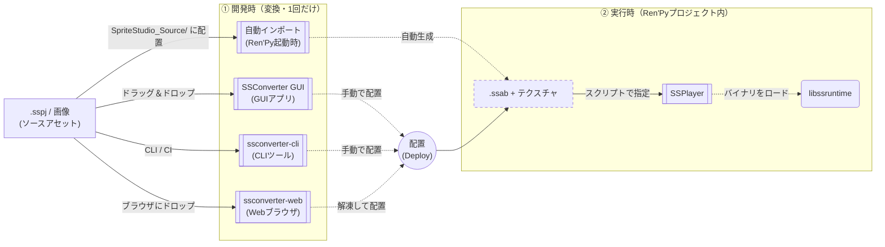

# 🗂️ アニメーションデータのコンバート (Import)

`.sspj` は **開発時に一度だけ** `.ssab` へ変換し、**実行時（ゲームプレイ中）** はその `.ssab` とテクスチャを読み込んで描画するだけです。プレイヤーに配布するゲーム本体に元の `.sspj` 等を含める必要はありません。

プロジェクトの規模やワークフローに合わせて、以下のコンバート方法を提供しています。



> [!TIP]
> 手元に `.sspj` がまだ無い状態で試したい場合は、[SpriteStudio 公式のサンプルデータ](https://www.webtech.co.jp/help/ja/spritestudio7/download/sample/)がそのまま使えます。キャラクターなら [Ringo](https://www.webtech.co.jp/help/ja/spritestudio7/download/sample/#ringo)、エフェクトを含むものなら [パーティクル](https://www.webtech.co.jp/help/ja/spritestudio7/download/sample/#Perticle_sample) が手頃です。ダウンロードしたプロジェクト一式は、以下のどのコンバート方法にもそのまま渡せます。

> [!NOTE]
> **どの SpriteStudio ファイルが、変換後のどれになるのか**（`.sspj` / `.ssae` / `.ssce` / `.ssqe` の役割と対応）は Player 共通なので、ポータルにまとめてあります —
> [アセットの変換 — プロジェクトの構成と、変換後の対応](https://cri-middleware.github.io/SpriteStudio-Docs/ja/overview/conversion/#プロジェクトの構成と変換後の対応)。
>
> 要点は 2 つです。**`.ssae` 1 本が `.ssab` 1 本**になること、そして**セルの切り出し位置は `.ssce` から `.ssab` へ焼き込まれる**こと。後者があるため、セルを追加・移動・リサイズしたり画像サイズを変えたりしたときは、**画像だけでなく `.ssab` も作り直して一緒に配置**してください。画像だけを新しくすると、古い切り出し位置のまま描画されて絵がずれます。

---

## 方法1: 自動インポート機能 (Auto Importer)

Ren'Pyの起動時に `.sspj` ファイルの更新を自動で検知し、裏側でコンバートを実行してゲーム内に取り込む機能です。手動コンバートの手間を省き、素早くイテレーション（調整・確認）を回したい場合におすすめです。

> [!WARNING]
> この機能は **開発者モードでのみ** 動作します。Ren'Py ランチャーから起動したゲームは開発者モードです。プレイヤー向けのリリースビルドでは変換しません。

### 基本的な使い方

1. ゲームプロジェクトのルートディレクトリ（`game/` フォルダと同じ階層）に **`SpriteStudio_Source`** という名前のフォルダを作成します。
2. 作成した `SpriteStudio_Source` フォルダの中に、SpriteStudioで作成したプロジェクト一式（`.sspj`, `.ssae`, 画像など）を配置します。
3. Ren'Py ランチャーで **プロジェクトの起動** を押します。起動中のゲームでは、`Shift + R` でホットリロードをオンにすると取り込まれます（下記参照）。

**実行結果:**
起動時の初期化フェーズでファイルの更新が検知されると自動的にコンバートが走り、プロジェクト名と同名のフォルダが **`game/ss_assets/`** 以下に生成されます。（例: `SpriteStudio_Source/Ringo/Ringo.sspj` を配置した場合、`game/ss_assets/Ringo/` に変換データが出力されます）

> [!NOTE]
> **出力先はプロジェクト名ごとに 1 つです。** 出力フォルダは `.sspj` のファイル名で決まるので、`Enemies/Boss/Enemy.sspj` と `Enemies/Minion/Enemy.sspj` のように同じ名前のプロジェクトは、どちらも `game/ss_assets/Enemy/` に書き込むことになります。このときはパス順で最初の 1 つだけを変換し、残りはスキップして、ゲーム内の通知とコンソールにどれをスキップしたかを表示します。両方を取り込むには、どちらかの `.sspj` の名前を変えてください。大文字と小文字だけが違う名前も、Windows と macOS では同じフォルダになるので、同じ名前として扱います。
>
> **SpriteStudio Player for Ren'Py を更新すると、全プロジェクトをもう 1 回変換します。** 最後に変換したコンバーターと `game/spritestudio/` に入っているコンバーターが違えば変換し直すので、新しいリリースに差し替えた次の起動で、全プロジェクトが最新の変換結果になります。その起動は普段より時間がかかります。
>
> **インポーターは何も削除しません。** `.ssae` や画像、音声を消したり名前を変えたりしても、そこから変換されたファイルは `game/ss_assets/<project>/` に残り、読み込めて、アセットブラウザに並び、画像として登録され、ゲームにも同梱されます。インポーターは変換のたびにそうしたファイルをコンソールに書き出し、ゲーム内の通知にも件数を出すので、使っていないものは手で削除してください。

### ホットリロード

起動中のゲームで **`Shift + R`** を **1 回** 押せば、あとは押す必要がありません。Auto Importer が `SpriteStudio_Source/` のファイルを Ren'Py のオートリロードに登録するので、以降は **SpriteStudio で保存するだけで再インポートとリロードが自動で走ります**。更新日時で変更を検知し、変更のあったプロジェクトだけを再コンバートしてアセット索引を更新します。フォルダに新しいプロジェクトを丸ごと置いた場合も同じです。取り込みの結果は実行中のゲームに表示されます（`SpriteStudio: imported Ringo`、失敗時は失敗したプロジェクト名とコンソールを見るよう促す同じ行）。保存が反映されなかったときに無言にならないためです。

> [!WARNING]
> **`Shift + R` は Ren'Py のオートリロードの切り替えであって、更新ボタンではありません。** 1 回目の押下でオートリロードが **オン** になりリロードされますが、もう一度押すと **オフ** になり、リロードは起きません（2 回目が「何も起きない」ように見えるのはこのためです）。起動ごとに 1 回だけ押して、あとはそのままにしてください。どちらの状態かは起動時に Auto Importer が出力します（`Hot reload ON` / `Hot reload OFF`）。`Alt`（`Option`）`+ R` も同じ操作です。`Ctrl + R` は割り当てられていません（`Ctrl` は Ren'Py のスキップキーです）。

> [!TIP]
> **動作イメージ — 外部ツール連携によるライブイテレーション。** SpriteStudio でアニメーションを編集して保存すると、ホットリロードがオンなら、起動中の Ren'Py が変更のあったプロジェクトだけを再コンバートし、その場で結果を表示します（開発者モード限定）。
>
> <video autoplay loop muted playsinline width="100%">
>   <source src="assets/1-auto_import_live.webm" type="video/webm">
> </video>
> 

> [!TIP]
> **出力パスのカスタマイズ**ソースとなる配置場所や出力先パスを変更したい場合は、Ren'Pyスクリプト側で変数を定義して上書きできます。
> ```renpy
> # 例: options.rpy 等でオートインポーター（init -10）より先に定義する
> define -15 ss_source_dir = "my_custom_source_folder"
> define -15 ss_output_dir = "game/my_converted_assets"
> ```

---

## 方法2: 専用GUIツール (SSConverter GUI) による手動変換

コマンドライン操作に慣れていない方や、ドラッグ＆ドロップで手軽に変換したい場合は、専用のデスクトップアプリケーション **SSConverter GUI** の利用をおすすめします。

### ダウンロードと使い方

1. [SSConverter GUI の Releases ページ](https://github.com/cri-middleware/SSConverterGUI/releases) から、お使いの OS に合った最新版をダウンロードして起動します。
2. アプリケーションウィンドウの指定エリアに、変換したい `.sspj` ファイル、または `.sspj` が含まれるフォルダを直接 **ドラッグ＆ドロップ** します。
3. （オプション）出力先ディレクトリを指定し、「Convert」ボタンを押すと一括で `.ssab` が生成されます。
4. 完了後、出力されたフォルダをご自身のRen'Pyプロジェクトの `game/` ディレクトリ内（例: `game/ss_assets/Ringo/`）に手動で配置してください。

> [!NOTE]
> フォルダをドロップするだけで内部の `.sspj` を自動で探し出して一括変換できるため、非常に簡単です。

---

## 方法3: CLIコンバータ (`ssconverter-cli`) による CLI / CI

CI/CD (継続的インテグレーション) での自動ビルドや、大規模プロジェクトで一括バッチ処理を行いたい場合は、独立した実行ツールである **`ssconverter-cli`** の利用がおすすめです。Godot や Unity 向けなどでも共通して使われているこのツールを使えば、PythonやRen'Pyの実行環境がなくてもコマンドラインから直接コンバート処理を行えます。

### ダウンロード方法

[SpriteStudio-SDK の Releases ページ](https://github.com/cri-middleware/SpriteStudio-SDK/releases) から、お使いのOSに合った `ssconverter-cli` の実行可能ファイル（Windows向けは `ssconverter-cli.exe` 等が含まれたZIP）をダウンロードし、任意のフォルダに展開してください。

> [!NOTE]
> `ssconverter-cli` バイナリは、SpriteStudio Player for Ren'Py には同梱されていません。CLI を利用する場合は SDK リポジトリ側から別途取得してください。

### 基本的な使い方

ターミナル（コマンドプロンプトやバッチファイル）を開き、以下のコマンドを実行します。`-o` オプションを使わずに入力ファイルのみを指定するのが最も簡単です。

```bash
# 基本構文
ssconverter-cli <入力ファイルパス.sspj>

# 実行例
ssconverter-cli SpriteStudio_Source/Ringo/Ringo.sspj
```

- 上記を実行すると、`.sspj` ファイルと同じディレクトリ内にプロジェクトと同名のフォルダ（例: `Ringo/`）が生成され、その中に `.ssab` や画像ファイルが出力されます。
- コンバート完了後、生成されたフォルダをご自身のRen'Pyプロジェクトの `game/` ディレクトリ内（例: `game/ss_assets/Ringo/`）に手動で移動・配置してください。
- ※任意の場所へ直接出力したい場合は、`-o <出力先ディレクトリパス>` オプションを使用することも可能です。

### ディレクトリ指定による一括バッチ処理

ファイル単位ではなくディレクトリのパスを指定することで、そのディレクトリ内にあるすべての `.sspj` プロジェクトを自動的に探し出して一括コンバートしてくれます。

```bash
# 指定フォルダ以下の全プロジェクトを一括コンバート
ssconverter-cli SpriteStudio_Source/
```
複数のキャラクターやシーンのアニメーションデータを一気に変換・更新したい場合に非常に便利です。

---

## 方法4: Webブラウザ版コンバータ (`ssconverter-web`)

インストール不要で、手元のブラウザ上で手軽に変換を試したい場合は、姉妹プロジェクトである SpriteStudio Player for Web に付属する **`ssconverter-web`** を利用することもできます。

- WebAssembly を利用してブラウザ内でローカル処理を行うため、ファイルが外部サーバーに送信されることはありません。
- 変換したい `.sspj` と関連ファイル（画像など）をブラウザ画面にドラッグ＆ドロップすると変換処理が走り、結果が **`.zip` 形式でダウンロード** されます。
- ダウンロードされた `.zip` を解凍し、生成された `.ssab` と画像を一緒にご自身の `game/` フォルダ内に配置してください。

SpriteStudio Player for Web のサイト内、[`https://cri-middleware.github.io/SSPlayerForWeb/ssconverter/`](https://cri-middleware.github.io/SSPlayerForWeb/ssconverter/) で公開されています。フォルダ選択に **File System Access API** を使うため、**Chromium 系ブラウザ（Chrome / Edge）** が必要です。

詳しくは [SSPlayerForWeb リポジトリ](https://github.com/cri-middleware/SSPlayerForWeb) のドキュメントをご参照ください。

---

## リリースビルドとアーカイブ (`.rpa`)

`.ssab` とテクスチャ（PNG / WebP）は Ren'Py のローダ経由で読み込むため、**`.rpa` アーカイブに含めても読み込めます**。テクスチャは Ren'Py 標準の画像パイプライン（`Image`）を通るため、Ren'Py が対応する形式（PNG / WebP）はプロジェクト内の他の画像とまったく同じように扱えます。配布ビルドで `game/` をアーカイブ化する場合（`build.classify` 等）も、これらをそのままアーカイブに入れて構いません。ルースファイルのままでも動作します。
