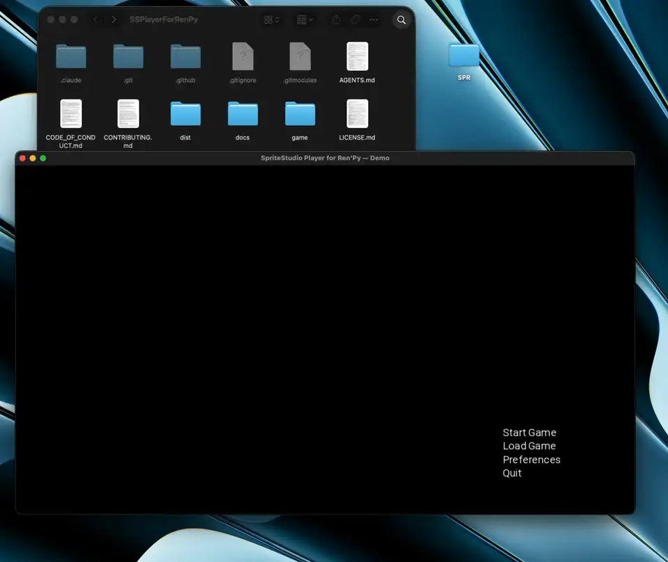
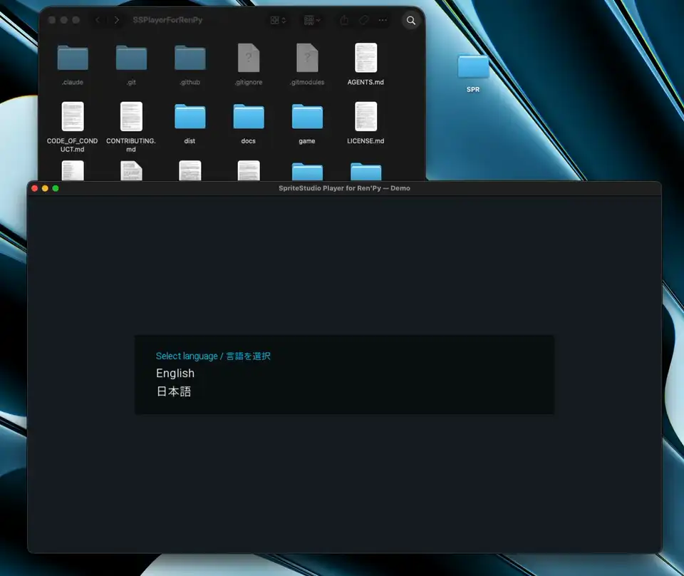

# 再生と制御 (Usage Guide)

SpriteStudio Player for Ren'Py では、SpriteStudioのアニメーションをRen'Py上で非常に柔軟に制御できます。画面への単純な描画から、キャラクターの立ち絵としての統合、イベントコールバックまで、目的に応じた使い方を解説します。

> [!IMPORTANT]
> **`.ssab` の置き場所について**
> コンバート済みの `.ssab` とそのテクスチャ（`.png`）、および参照する外部インスタンスパックは、すべて **同じフォルダに同居** します（オートインポーターは `game/ss_assets/<プロジェクト名>/` に出力します）。プレイヤーは関連リソースを `.ssab` と同じフォルダから解決するため、テクスチャ用のフォルダを別途指定する必要はありません。

---

## 1. 最も簡単な再生（Screenからの呼び出し）
`SSPlayer` クラスは Ren'Py の Displayable（描画オブジェクト）として振る舞うため、スクリーン内に `add` して直接表示するのが最もシンプルです。

```renpy
screen demo():
    # 第1引数は .ssab のパス（game/ からの相対パス）
    add SSPlayer("ss_assets/Ringo/Ringo.ssab") xalign 0.5 yalign 0.5
```

### 基本パラメータ
- **第1引数**: 再生する `.ssab` のパス（`game/` からの相対、例 `"ss_assets/Ringo/Ringo.ssab"`）。`.ssab` とそのテクスチャ・外部インスタンスパックは同居しているので、これだけで関連リソースも解決されます。**`.rpa` アーカイブ内の `.ssab` も読み込めます**（Ren'Py のローダ経由）。
- **`animation` (省略可能)**: 初期状態で再生するアニメーション名。省略時はデータ内の最初のアニメーションが再生されます。**存在しない名前を渡すと初回表示時にエラー**（有効なアニメーション名の一覧つき）になります。
- **`loop` (省略可能)**: 再生回数。`-1`（既定）で無限ループ、`1` で1回再生、`N` でN回再生。`0` は `-1`（無限）の別名で、「再生しない」ではありません。
- **`speed` (省略可能)**: 再生速度の倍率（既定 `1.0`）。
- **`size` (省略可能)**: `(w, h)`（または正方形なら数値1つ）を渡すと、その**箱サイズの普通の画像**として振る舞い、`xalign`/`xpos`/`pos` やコンテナ配置がそのまま効きます（アニメは箱の中央に描画）。省略時は画面全体を占有するので `xoffset`/`yoffset` で位置調整します。どちらの場合も `zoom`/`Transform` での拡大縮小は効きます。

```renpy
# size を指定すれば align で配置できる
add SSPlayer("ss_assets/Ringo/Ringo.ssab", size=(400, 600)) xalign 0.5 yalign 1.0
```

> [!TIP]
> どのパック／アニメーションを使えばいいか分からないときは、開発者モードで **Shift+B** から **アセットブラウザ** を開けば、全 `.ssab` を一覧・ライブプレビューし、貼り付け可能なスニペットをコピーできます。詳細は下の **アセットブラウザ**（§8）を参照。

> [!NOTE]
> 旧 `sprites_subdir` 引数は後方互換のために残っていますが、パス指定で不要（非推奨）です。

---

## 2. 立ち絵としての利用 (image 宣言と Character 連携)
Ren'Pyの `image` ステートメントと組み合わせることで、ノベルゲームにおける**キャラクターの立ち絵**として強力に機能します。`aliases` 引数を使うと、Ren'Pyのアトリビュート名とSpriteStudio内のモーション名を紐付けることができます。

```renpy
# キャラクターの定義（.ssab パスを指定）
image ringo = SSPlayer(
    "ss_assets/Ringo/Ringo.ssab",
    aliases={
        "idle": "wait1",    # 'idle' が呼ばれたら 'wait1' モーションを再生
        "happy": "joy",
        "walk": "walk",
        "attack": ["attack1", "wait1"] # リストを渡すと順番に連続再生！
    }
)

define r = Character("Ringo", image="ringo")

label start:
    # デフォルトの立ち絵を表示（idleモーション）
    show ringo idle:
        yoffset 200

    r happy "アトリビュートを変えるだけでモーションが切り替わるよ！"

    # Transform (移動) と組み合わせて歩かせる
    show ringo walk:
        xoffset -400 yoffset 200
    with move

    r attack "攻撃！ (attack1 が終わると自動的に wait1 に戻ります)"
```

### もっと簡単に：喋るキャラ (`SSCharacter`)
`SSCharacter` を使うと、**台詞を喋っている間は talk、止まれば idle に自動で切り替わる**“生きたキャラ”を1行で定義できます。`image` 宣言と `Character` の準備、しゃべりへの同期がまとめて行われ、行ごとの Python は不要です。

```renpy
# 画像登録 + Character + 口パク連動をまとめて定義（タグは .ssab の stem = "ringo"）
define ringo = SSCharacter(
    "ss_assets/Ringo/Ringo.ssab",
    talk="talk",     # 喋っている間に再生するアニメ名
    idle="wait1",    # 無音時のアニメ名
)

label start:
    show ringo            # タグ "ringo" で表示
    ringo "やあ。喋っている間は talk、終わると idle に戻るよ。"
```

- 画像タグは `.ssab` のファイル名 stem を小文字化したもの（例 `"ringo"`）。`tag=` で上書き可。
- `aliases=`（感情など）や `size=`（`xalign` を効かせる箱サイズ）も渡せます。
- 口パクの開始/終了タイミングは `start` / `stop`（Character のコールバックイベント名）で調整可能。

> [!WARNING]
> **v1の制限**: 喋っている間は talk/idle が属性を置き換えるため、`show ringo happy` のような感情属性は talk 中は反映されず、終了後 `idle` に戻ります（感情別の talk は今後対応）。

---

## 3. エフェクトとしての利用 (ループ回数の制御)
魔法の爆発やヒットエフェクトなど、一度だけ再生して終わるアニメーションの場合は、`loop` 引数で再生回数を制限できます。

```renpy
image hit_effect = SSPlayer(
    "ss_assets/ParticleEffect/e038.ssab",
    animation="hit",
    loop=1 # 1回再生したら終了して画面から消える（または最後のフレームで止まる）
)

label battle:
    # 攻撃に合わせて指定位置にエフェクトを表示
    show hit_effect:
        xoffset -150 yoffset 50
    "ドガァン！"
```

---

## 4. Pythonコードからの動的制御
ゲーム中の処理に応じてPython（スクリプト）から直接アニメーションを切り替えたり、情報を取得したりすることも可能です。

```renpy
$ player = SSPlayer("ss_assets/Ringo/Ringo.ssab")

# 収録されているすべてのアニメーション名リストを取得
$ anim_names = player.ss_animation_names()

# 現在再生中のアニメーション名を取得
$ current_anim = player.ss_get_animation()

# 任意のアニメーションへの切り替え（読み込み＋頭出し → 再生）
$ player.ss_play("run")
```

- **読み込みと再生の分離**: `ss_set_animation("run")` はアニメーションを読み込んでポーズ（頭出し）するだけで、再生は開始しません。`ss_play()` で再生を開始します。
- **再生制御**: `ss_pause()` / `ss_resume()` / `ss_stop()`、フレーム操作 `ss_set_frame()` / `ss_get_frame()`、速度 `ss_set_speed()`、ループ `ss_set_loop()` などが利用できます。
- **パーツ照会**: `ss_part_transform("part名")` で直近フレームのパーツのローカル変換（x/y/回転/スケール）を取得できます。

---

## 5. パーツオーバーライド（カラー / セル / 表示）

パーツオーバーライドは、特定のパーツに対して「**今**この色にする・このセルを描く・隠す」と指示する機能です。解決済みのポーズに対して適用されるため、キーフレームにもアニメーションのブレンドにも優先します。マフラーの色を変えたり帽子を隠したりするのに、アニメーションと張り合う必要はありません。

```renpy
$ ringo = SSPlayer("ss_assets/Ringo/Ringo.ssab", animation="wait1")

# パーツを赤く着色（1 = Mul）。通常（画像）パーツのみ対象
$ ringo.ss_set_part_color_override("apple", "#f00", blend_op=1)

# パーツに別のセルを描かせる（セルマップ名に ".ssce" は付けない）
$ ringo.ss_set_part_cell_override("apple", "Ringo", "effect3")

# パーツを強制的に隠す。子孫にも波及させる
$ ringo.ss_set_part_visibility_override("apple_base", True, cascade=True)

# 元に戻す
$ ringo.ss_clear_part_color_override("apple")
$ ringo.ss_clear_all_part_overrides()
```

| メソッド | 説明 |
|---|---|
| `ss_set_part_color_override(part, color, blend_op=0, priority=1)` | カラーオーバーライド（パーツ全体を単色で） |
| `ss_set_part_color_override_corners(part, corners, blend_op=0, priority=1)` | 四隅の色を個別に指定（`左上, 右上, 左下, 右下` の順） |
| `ss_set_part_cell_override(part, cellmap_name, cell_name, priority=1)` | 別のセルを描画させる |
| `ss_set_part_visibility_override(part, hide=True, cascade=False)` | 強制的に隠す（`hide=False` でアニメーションに戻す） |
| `ss_clear_part_color_override(part)` / `ss_clear_part_cell_override(part)` / `ss_clear_part_visibility_override(part)` | 1パーツの1オーバーライドを解除 |
| `ss_clear_all_part_overrides()` | そのプレイヤーの全オーバーライドを解除 |
| `ss_cellmap_names()` / `ss_cell_names(cellmap_name)` | 読み込み済みパック内の、セルオーバーライド対象を列挙 |

`part` にはパーツ名またはそのインデックス（`ss_part_index("apple")`）を渡せます。インデックスは同一 `.ssab` 内で安定しているので、頻繁にオーバーライドする場合は名前を一度だけ解決してインデックスを使い回してください。各メソッドは、パーツが見つからない場合やランタイムが呼び出しを拒否した場合に `False` を返します。

**色**は Ren'Py の任意の色表現を受け付けます（`"#f00"`、`(255, 0, 0)`、`Color(...)`）。SpriteStudio で設定したパーツカラーと同じ 8bit sRGB 空間で解釈され、アルファの事前乗算はランタイム側で行われるため、変換せずそのまま渡してください。

### ブレンド演算 (`blend_op`)

キーフレームのパーツカラーと同じ4種類の演算です。範囲外の値を渡すと呼び出しは失敗し `False` を返します。

| 値 | ブレンド演算 |
|---|---|
| `0` | Mix（デフォルト） |
| `1` | Mul（乗算） |
| `2` | Add（加算） |
| `3` | Sub（減算） |

### 優先モード (`priority`)

カラーとセルのオーバーライドはアニメーションと競合するため `priority` を取ります。表示（visibility）にはありません。常に優先され、新しいアニメーションのセットアップ時に必ず解除される単純な強制非表示フラグです。

| 値 | 優先モード | 挙動 |
|---|---|---|
| `0` | OverwriteOnNextKeyframe | その属性の次のキーフレームに再生が到達するまで適用される |
| `1` | HoldUntilNextAnimation（デフォルト） | 現在のアニメーションの間は優先され、新しいアニメーションのセットアップ時に解除される |
| `2` | Permanent | 同じ `.ssab` を再生している限り、アニメーション切り替えを越えて持続する |

### 注意点

- **カラー**は通常パーツ、**セル**は通常パーツとマスクパーツが対象です。それ以外の種別のパーツでは黙って無視されます（呼び出し自体は `True` を返します）。
- セルオーバーライドは設定した時点で解決されるため、存在しないセルマップ名／セル名はその場で失敗します。有効な名前は `ss_cellmap_names()` / `ss_cell_names()` で列挙できます。
- オーバーライドの設定・解除を行うと、一時停止中や停止中でも即座に再描画されます。
- オーバーライドはセーブデータのロード時に復元されます。ただしワンショット（`priority=0`）のオーバーライドは例外で、一時的な指定という性質上、セーブを跨いでは引き継がれません。
- インスタンスパーツの**内部**のパーツには届きません（その子アニメーションは別のプレイヤーとして動作するため）。インスタンスパーツ自体を強制的に隠せば、その中身も描画されなくなります。

---

## 6. アニメーションイベント（ユーザーデータ / シグナル）の処理
SpriteStudio側で設定した「ユーザーデータ」や「シグナル」の情報をRen'Py側で受け取ることができます。これにより、特定のフレームで効果音を鳴らしたり、スクリプトの進行を同期させたりすることが可能です。

### コールバック（イベント駆動）による受け取り
`SSPlayer` のインスタンス生成時に、各イベントに対応した関数を渡すことで、特定のタイミングで処理を発火させることができます。

```python
init python:
    def my_signal_handler(player, frame, signal):
        print(f"シグナルを受信: コマンド={signal.command_id}, 引数={signal.params}")

    def my_finish_handler(player):
        print("アニメーションが最後まで再生されました")
```
```renpy
# コールバックを登録して再生
image boss = SSPlayer(
    "ss_assets/Boss/Boss.ssab",
    on_signal=my_signal_handler,
    on_finished=my_finish_handler
)
```

**利用可能なコールバック引数:**
- `on_user_data`: ユーザーデータ到達時に呼ばれる
- `on_signal`: シグナル到達時に呼ばれる
- `on_audio`: 音声再生指定フレーム到達時に呼ばれる
- `on_finished`: 指定した `loop` をすべて再生し終えたときに1回呼ばれる。無限ループでは発火せず、停止操作でも発火しない
- `on_looped`: ループ完了ごと（1周回るごと）に呼ばれる。最終周はループせず `on_finished` になる
- `on_started`: アニメーション再生開始時に呼ばれる

> [!NOTE]
> コールバックは描画スレッドから `cb(player, ...)`（開始/終了/ループ系は `cb(player)`）の形で呼ばれます。ロールバック（rollback）時のピクル化のため、ラムダやローカル関数ではなくモジュールレベルの関数を渡してください。

※ ポーリングベース（`ss_poll_events()`）での受け取り方については、デモプロジェクトの `script.rpy` 内 `ss_drain_events()` などの実装をご参照ください。

---

## 7. 便利機能

### 一発再生を手軽に（`ss_play_once`）
任意の `.ssab` を一度だけ再生（エフェクトでも全画面カットシーンでも）。`wait=True` で再生し終わるまで待ってから自動で消します。待たずに出したものは `ss_hide_once(tag)` で消せます。
```renpy
$ ss_play_once("ss_assets/ParticleEffect/e038.ssab", "hit",
               at=Transform(xpos=640, ypos=360), wait=True)
```
`ss_duration("…/Ringo.ssab", "attack1")` はそのアニメ1周の秒数を返すので、表示中キャラの「再生して待つ」は `show ringo attack` ＋ `$ renpy.pause(ss_duration(...))` で書けます。

### パーツに何かを貼る（`attachments`）
名前付きパーツ（手・頭など）に表示物を追従させます（v1は平行移動のみ）。
```renpy
image ringo = SSPlayer(
    "ss_assets/Ringo/Ringo.ssab",
    attachments={"head": Text("！", size=40), "hand_r": "sword.png"},
)
```

### 動作確認（診断）
開発者モードでは起動時に「runtime loaded / N pack(s)」がログ出力されます。コンソール（Shift+O）で `ss_diagnostics()` を呼ぶと、ランタイムの状態と検出済みパック一覧を確認できます。`.ssab` が読めない場合は、パス（`game/` からの相対）を含む分かりやすいエラーになります。

---

## 8. アセットブラウザ (Shift+B)：一覧・プレビュー・スニペット生成

開発者モードで **Shift+B** を押すと **アセットブラウザ** が開きます。「どのパックを、どう再生すればいいのか？」を数クリックで解決する組み込みインスペクタです。開発者モード限定（リリースビルドではホットキーが無効）で、実行中のゲームにオーバーレイ表示されるため、いつでも呼び出せます。

> [!TIP]
>
> <video autoplay loop muted playsinline width="100%">
>   <source src="../../assets/2-asset_browser.webm" type="video/webm">
> </video>
> 

ウィンドウは3ペイン構成です。

1. **パック一覧（左）**：リゾルバが `ss_assets/` 配下で見つけた全 `.ssab`（`.rpa` アーカイブ内も含む）。クリックで選択します。
2. **ライブプレビュー（中央）**：選択したアニメーションが実際に再生されます（静止サムネイルではありません）。あわせて `animations`（数）・`fps`・`effects` の有無・外部インスタンスパックといったメタ情報を表示。一覧のアニメをクリックすれば即座に切り替わります。
3. **スニペット（右）**：**ロール**（Character / One-shot / UI）を選ぶと、そのパック用の貼り付け可能な `.rpy` スニペットが生成されます。デフォルトのロールはパック内容から推定される（例：エフェクトのみのパックは One-shot）ため、アニメを見ながら用途を選べます。

書き出すと、スニペットはプロジェクト直下の **`ss_snippets.txt`** に追記され、クリップボードにもコピーされるので、そのままスクリプトへ貼り付けられます。**Esc** で閉じます。

ブラウザは `SSPlayer` と同じゼロコンフィグのリゾルバ経由で読み込むため、一覧に出たものは表示パスそのままで確実にロードできます（[Auto Importer](import.md) が生成した直後のパックも、インポート時に索引が更新されるため含まれます）。

### Auto Importer と連動する

新しいパックを取り込むのに再起動は不要です。`SpriteStudio_Source/` に新規プロジェクトを置いて **Shift+R** でリロードすると、[Auto Importer](import.md) が変換して索引を更新します。ブラウザを開き直せば（**Shift+B**）、新しいパックが一覧に現れ、その場でプレビューできます。

> [!TIP]
>
> <video autoplay loop muted playsinline width="100%">
>   <source src="../../assets/3-asset_browser_autoimport.webm" type="video/webm">
> </video>
> 
